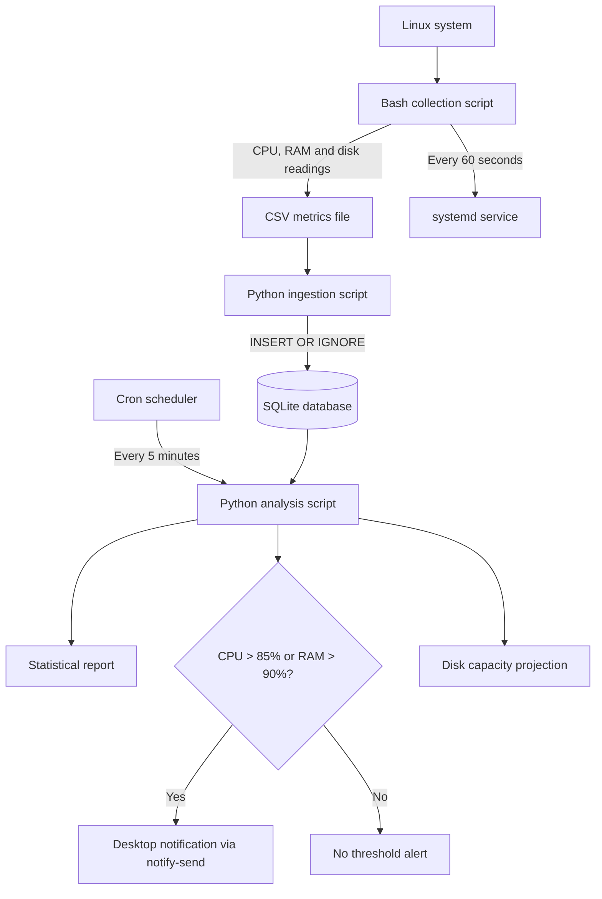

<div align="center">

# S³A — Smart Server Stats Analyser

### A lightweight, CLI-first Linux system monitoring and resource analysis utility

[](https://www.kernel.org/)
[](https://www.gnu.org/software/bash/)
[](https://www.python.org/)
[](https://www.sqlite.org/)
[](https://systemd.io/)
[](https://man7.org/linux/man-pages/man5/crontab.5.html)

**Version 1.0 · Working project**

</div>

---

## Overview

**Smart Server Stats Analyser (S³A)** is a lightweight, command-line-oriented monitoring utility for Linux systems. It periodically collects CPU, memory and disk statistics, stores the readings locally, analyses the accumulated data, and sends desktop notifications when CPU or RAM usage crosses configured thresholds.

The project is built around small, focused components rather than a large monitoring stack:

- **Bash** collects system metrics.
- **Python** ingests the collected CSV records into a database and performs analysis.
- **SQLite** provides local, persistent metric storage.
- **systemd** manages the continuous collection service.
- **Cron** schedules periodic analysis.

The goal of Version 1.0 is to demonstrate a practical end-to-end monitoring workflow: **collect → store → analyse → alert**.

## Features in Version 1.0

| Capability | Current behaviour |
|---|---|
| CPU monitoring | Collects user, system and I/O-wait CPU percentages |
| Memory monitoring | Collects total, used and available RAM |
| Disk monitoring | Collects total, used and available space for the root filesystem |
| Periodic collection | Bash collector runs every 60 seconds under a systemd service |
| Data ingestion | Python imports CSV records into SQLite |
| Duplicate handling | Timestamp is unique; duplicate rows are ignored during insertion |
| Scheduled analysis | Analysis script runs every 5 minutes through cron |
| Statistical summary | Reports Mean, P95, Peak and Standard Deviation |
| CPU alert | Sends a desktop alert when CPU busy usage exceeds 85% |
| RAM alert | Sends a desktop alert when RAM usage exceeds 90% |
| Disk projection | Estimates time to full capacity when observed disk usage is increasing |
| Output | Prints a report in the terminal and uses `notify-send` for alerts |

> **Scope note:** Version 1.0 is a local, single-machine monitoring utility. It does not currently provide a web dashboard, remote monitoring, automatic process termination, process-level attribution, or a multi-host monitoring service.

## Architecture



### Component responsibilities

#### 1. Collection — Bash

`StatsC1.sh` is responsible for sampling the host system. It gathers:

- CPU user time percentage (`us`)
- CPU system time percentage (`sy`)
- CPU I/O-wait percentage (`wa`)
- Root filesystem total, used and available space
- RAM total, used and available values

The script creates the metrics directory and CSV header when required, appends a timestamped record, invokes the ingestion script, and waits 60 seconds before the next collection cycle.

The collection script is operated as a **systemd service**, allowing it to run continuously under the service manager.

#### 2. Ingestion — Python and SQLite

`ingest.py` reads the CSV data and writes it to `system_metrics.db`.

The database table, `system_metrics`, stores a timestamp and the collected CPU, disk and RAM fields. The timestamp has a `UNIQUE` constraint, and the importer uses `INSERT OR IGNORE`. This makes repeated imports idempotent for records that have already been inserted.

The current importer reads the CSV file and prepares its rows for insertion on each invocation. This is straightforward for the initial local workload; incremental ingestion can be considered as the dataset grows.

#### 3. Analysis — Python

`analyze.py` retrieves the stored records and derives the following measures:

| Reported measure | Purpose |
|---|---|
| Mean (average) | Shows average resource usage across the recorded period |
| P95 | Shows the value at the 95th-percentile position in the sorted readings |
| Peak (maximum) | Shows the highest recorded value |
| Standard deviation | Indicates variation in the readings |

The report covers:

- **CPU Busy** — calculated from user CPU plus system CPU
- **CPU Wait** — I/O-wait percentage
- **RAM Used** — calculated as used RAM divided by total RAM
- **Disk Used** — calculated as used disk space divided by total disk capacity

The analysis is scheduled through **cron every five minutes**.

#### 4. Alerting and disk projection

The analysis checks the latest stored reading for threshold breaches:

- CPU Busy **greater than 85%**
- RAM Used **greater than 90%**

When either condition is met, the script attempts to send a critical desktop notification using `notify-send`. The alert is informational: S³A does not kill processes or automatically change system state.

For disk capacity projection, the script compares the first and latest disk-used readings over the recorded time range. If disk usage has increased, it estimates the growth rate and the time remaining until the filesystem reaches capacity. If usage is stable or decreasing, it reports that no capacity breach is currently predicted from the observed trend.

## Engineering decisions

| Decision | Reasoning |
|---|---|
| CLI-first design | Keeps the tool lightweight and natural to operate on Linux systems |
| Bash for collection | Uses standard Linux command-line utilities for basic system readings |
| Python for ingestion and analysis | Separates data collection from data processing and makes analysis easier to extend |
| CSV as an intermediate format | Provides a simple, inspectable record of collected samples |
| SQLite for persistence | Avoids requiring a separate database server for a single-machine utility |
| Timestamp uniqueness + `INSERT OR IGNORE` | Prevents the same timestamped CSV record from being inserted repeatedly |
| systemd for collection | Uses the Linux service manager for a continuously running collector |
| Cron for analysis | Keeps periodic reporting independent from the collection loop |
| Threshold alerts rather than automatic remediation | Leaves operational decisions with the administrator and avoids terminating legitimate workloads |
| Python standard library | Keeps the current analysis and ingestion implementation dependency-light |

## Repository layout

The scripts expect the project to follow this directory arrangement:

```text
Smart-System-Stats-Analyzer/
├── Metrics/
│   ├── Container2.csv
│   └── system_metrics.db
└── Scripts/
    ├── StatsC1.sh
    ├── ingest.py
    └── analyze.py
```

- `Metrics/Container2.csv` is created and appended to by the collection script.
- `Metrics/system_metrics.db` is created and maintained by the ingestion script.
- `Scripts/` contains the Bash collector and the two Python scripts.

The metrics files are runtime data and are generated locally; they do not need to be committed to source control.

## Requirements

- A Linux system with Bash.
- Python 3.
- SQLite support (available through Python's standard-library `sqlite3` module).
- Standard Linux utilities used by the collector: `top`, `df`, `free`, `awk`, `tr`, `date`.
- `systemd` to manage the collection service.
- `cron` to schedule analysis.
- `notify-send` and a desktop notification session for visible desktop alerts.

The current scripts use Python standard-library modules; no third-party Python package is required by the supplied implementation.

## Setup and operation

### 1. Place the project directory

Clone or copy the repository to:

```text
$HOME/Smart-System-Stats-Analyzer
```

The current script paths are written relative to this directory name under the user's home directory. If you use a different location, update the paths in `StatsC1.sh` and keep the script/database directory relationships consistent.

### 2. Make the collection script executable

```bash
chmod +x "$HOME/Smart-System-Stats-Analyzer/Scripts/StatsC1.sh"
```

### 3. Configure the systemd service

Create and enable a systemd service that runs:

```bash
$HOME/Smart-System-Stats-Analyzer/Scripts/StatsC1.sh
```

The service unit is machine- and user-configuration-specific, so use the appropriate service type and user context for your Linux installation. After starting it, verify its status with:

```bash
systemctl status <your-collection-service>
```

If you configured it as a user service, use `systemctl --user` instead.

### 4. Schedule analysis with cron

Add an entry to the appropriate user's crontab, replacing the example path with the absolute path to your installation:

```cron
*/5 * * * * /usr/bin/python3 /home/USER/Smart-System-Stats-Analyzer/Scripts/analyze.py
```

Edit the crontab with:

```bash
crontab -e
```

The notification command requires an active desktop notification environment. A cron job running outside the desktop session may need the relevant session environment to be configured for `notify-send` to display notifications.

### 5. Check generated data and reports

```bash
# Inspect recent collected samples
tail "$HOME/Smart-System-Stats-Analyzer/Metrics/Container2.csv"

# Run ingestion manually if needed
python3 "$HOME/Smart-System-Stats-Analyzer/Scripts/ingest.py"

# Run analysis manually
python3 "$HOME/Smart-System-Stats-Analyzer/Scripts/analyze.py"
```

The analysis report is printed to standard output. The scheduled job can be configured to redirect output to a log file if desired.

## Example report

A report generated during development included the following fields:

```text
SYSTEM STATS ANALYZER REPORT (StdLib v1)

Total Logged Records : 256
Time Range           : 2026-10-27 18:08:08 to 2026-10-31 23:44:08

--- CPU BUSY % ---
Average (Mean) : 33.13%
95th Percentile: 95.70%
Peak (Max)     : 100.00%
Volatility (σ) : 25.44

--- CPU WAIT % ---
Average (Mean) : 0.42%
95th Percentile: 4.00%
Peak (Max)     : 38.10%
Volatility (σ) : 2.64

--- RAM USED % ---
Average (Mean) : 69.54%
95th Percentile: 86.46%
Peak (Max)     : 96.23%
Volatility (σ) : 13.38

--- DISK USED % ---
Average (Mean) : 21.31%
95th Percentile: 21.46%
Peak (Max)     : 21.46%
Volatility (σ) : 0.11
```

These values are an example from one recorded run, not expected values or performance guarantees. Disk projection output depends on the observed growth during the available sample period.

## Current limitations

Version 1.0 is intentionally small in scope. Its current limitations include:

- Monitoring is local to the machine where the scripts run.
- Disk collection currently targets the root filesystem (`/`).
- CPU and RAM alert thresholds are fixed in the analysis script.
- Alerts are based on the latest recorded sample when analysis runs; there is no alert history or notification deduplication mechanism.
- Disk exhaustion is a simple linear estimate based on the first and latest disk-used readings. It is a projection, not a guarantee.
- The CSV is re-read during each ingestion run; this may become inefficient as the file grows.
- Desktop alerts depend on `notify-send` and a suitable desktop session.
- There is no web interface, remote alert channel, automated remediation, or process-level attribution in this version.
- No automated test suite or packaging installer is included in Version 1.0.

## Future scope

The following are possible extensions; they are **not implemented features of Version 1.0**.

1. **Incremental ingestion** — track the last imported record or file offset to avoid re-reading the complete CSV on every cycle.
2. **Configurable thresholds** — move CPU and RAM limits into a configuration file or command-line options.
3. **Alert improvements** — add cooldowns, deduplication, recovery notifications and sustained-threshold checks to reduce noisy alerts.
4. **Process-level diagnostics** — capture top resource-consuming processes during a spike to help the administrator investigate the cause.
5. **Retention and database maintenance** — add configurable retention policies and controlled cleanup of older records.
6. **Richer reporting** — add historical comparisons, export options and optional charts.
7. **Remote notifications** — support a configurable channel for alerts when the administrator is not logged into the monitored machine.
8. **Multi-host support** — explore a central view for metrics collected from multiple Linux machines.
9. **Packaging and tests** — add installation/uninstallation scripts, configuration validation and automated tests.

## Project status

**Version 1.0 is implemented and working** for the local Linux monitoring workflow described above. The collector, ingestion pipeline, SQLite storage, scheduled analysis, threshold alerts and disk projection have been exercised during development.

The project is intended as a learning-focused systems utility and a foundation for further work in Linux administration, monitoring and DevOps.

## Technologies

<div align="center">

[](https://www.kernel.org/)
[](https://www.gnu.org/software/bash/)
[](https://www.python.org/)
[](https://www.sqlite.org/)
[](https://systemd.io/)

</div>

---

<div align="center">

**Built by Mridul Pathak**

*Learning Linux systems, automation and monitoring by building practical tools.*

</div>
